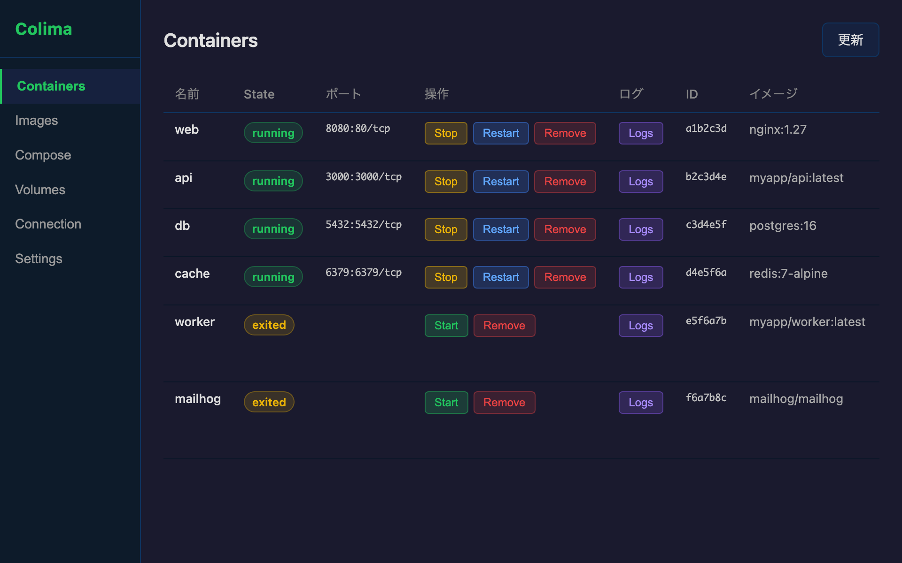
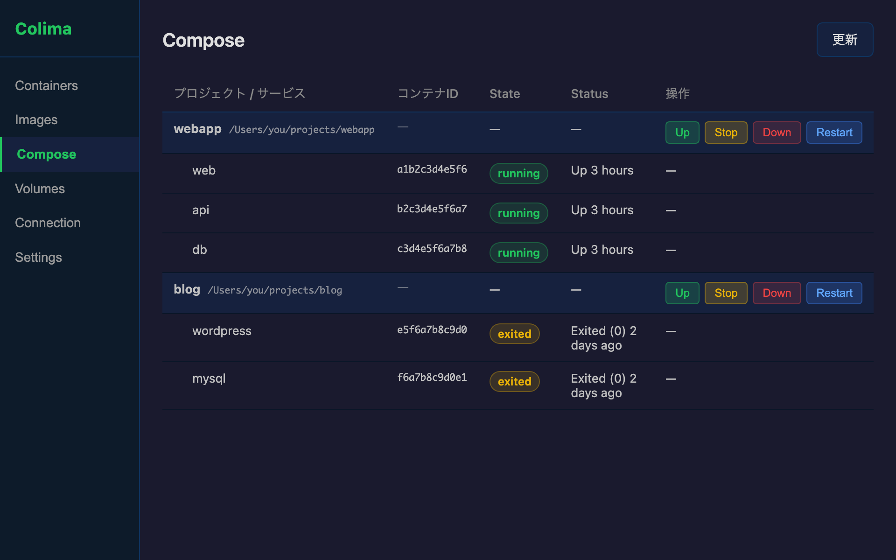
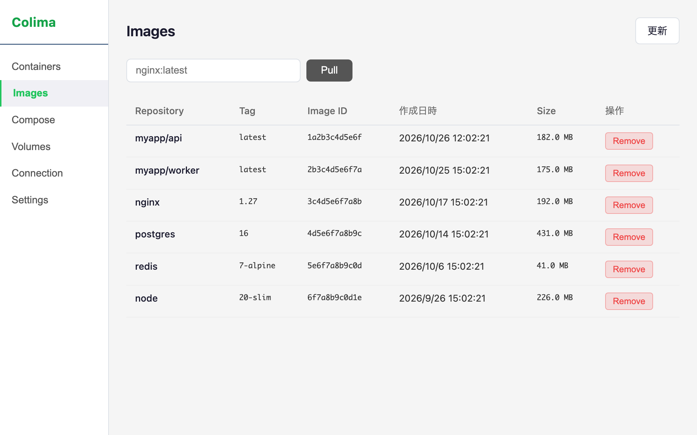
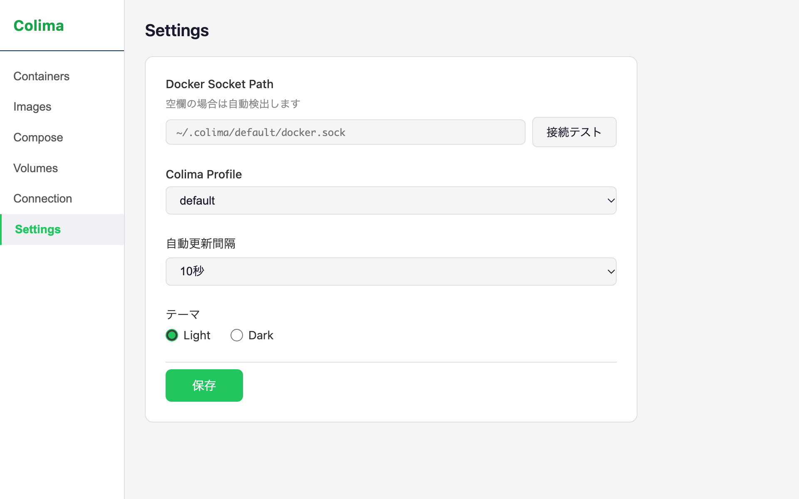

<div align="center">


# Colima Desktop

[English](README.en.md) | 日本語


**[Colima](https://github.com/abiosoft/colima) 向けの軽量な Docker 管理 GUI。**<br>
Docker Desktop なしで、コンテナ・イメージ・Docker Compose・Volume をメニューバーから操作できます。

</div>

| Containers | Docker Compose |
|---|---|
|  |  |
| **Images（ライトテーマ）** | **Settings（ライトテーマ）** |
|  |  |

## 特徴

- **Colima 専用設計** — Colima の Docker socket を自動検出。複数の Colima Profile も切り替えて管理できる
- **軽量** — Tauri v2 + Rust 製。メニューバーに常駐し、接続状態と実行中コンテナ数をひと目で確認できる
- **日常操作がひと通り揃う** — コンテナ / イメージ / Compose / Volume の管理と、Colima の起動・停止
- **ライト / ダーク両対応**

## 機能

| 画面 | できること |
|---|---|
| **Containers** | 一覧表示・Start / Stop / Restart / Remove・ログ表示 |
| **Compose** | プロジェクト単位の一覧・Up / Stop / Down / Restart |
| **Images** | 一覧表示・Pull・Remove |
| **Volumes** | 一覧表示・削除・未使用 Volume の一括削除（Prune） |
| **Connection** | Docker 接続確認・Colima Start / Stop・Profile 切り替え |
| **Settings** | socket path・Containers の自動更新間隔・テーマ（light / dark）の保存 |
| **メニューバー** | 接続状態と実行中コンテナ数の表示・ウィンドウの表示 |

削除系の操作は確認ダイアログを挟みます。

## インストール

> 配布用バイナリ（Releases）はまだ用意していません。現在はソースからのビルドが必要です。

### 必要なもの

| ツール | 備考 |
|---|---|
| macOS | Apple Silicon で動作確認 |
| [Colima](https://github.com/abiosoft/colima) と Docker CLI | Compose を使う場合は `docker compose` が必要 |
| [Node.js](https://nodejs.org/) 20.x | |
| [Rust](https://www.rust-lang.org/tools/install)（stable） | |

```bash
brew install colima docker docker-compose
```

### ビルドして /Applications に入れる

```bash
git clone https://github.com/kota-miyasaka/colima-desktop.git
cd colima-desktop
npm install
npm run tauri -- build

cp -R "src-tauri/target/release/bundle/macos/Colima Desktop.app" /Applications/
codesign --force --deep --sign - "/Applications/Colima Desktop.app"
```

コピー後の `codesign`（アドホック署名）は必須です。省略すると、起動時に署名検証で終了することがあります。

## 使い方

1. ターミナルで `colima start` を実行する（アプリの **Connection** 画面から Start / Stop することもできる）
2. **Colima Desktop** を起動する
3. 左のナビゲーションから Containers / Compose / Images / Volumes を切り替えて操作する

Containers 画面は **Settings** の「自動更新間隔」で定期更新できます（既定は off）。各画面の右上の「更新」ボタンで手動更新もできます。

## Docker socket の検出順

```
1. Settings 画面で保存した socketPath
2. ~/.colima/{profile}/docker.sock（profile 既定値: "default"）
3. DOCKER_HOST 環境変数
4. /var/run/docker.sock
```

## トラブルシューティング

**Disconnected と表示される**
`colima status` で Colima が起動しているか確認してください。Profile を使っている場合は **Connection** 画面で Profile を選ぶか、**Settings** で socket path を直接指定します。

**Compose の操作に失敗する**
Compose の Up / Stop / Down / Restart は `docker compose` コマンドを実行します。`docker compose version` が通るか確認してください。

**起動してもすぐ終了する**
インストール手順の `codesign` を実行したか確認してください。

## 開発

```bash
colima start
npm run tauri -- dev
```

Rust を Homebrew 経由の rustup で入れている場合、`cargo` が見つからなければ `~/.zshrc` に次を追加します。

```sh
export PATH="$HOME/.rustup/toolchains/stable-aarch64-apple-darwin/bin:$PATH"
```

### 技術構成

| レイヤー | 技術 |
|---|---|
| Desktop Shell | [Tauri v2](https://tauri.app/) |
| Frontend | React 18 + TypeScript |
| Backend | Rust |
| Docker Client | [bollard](https://github.com/fussybeaver/bollard) 0.17 |
| 設定保存 | tauri-plugin-store v2 |
| CLI 実行 | tokio::process::Command |

### ドキュメント

- [仕様書](doc/SPEC.md) — 機能スコープ・型定義・Tauri コマンド一覧
- [開発ガイド](doc/DEVELOPMENT.md) — アーキテクチャ・Tauri v2 の注意事項・実装パターン
- [バックエンド](doc/BACKEND.md) / [フロントエンド](doc/FRONTEND.md)

## コントリビュート

バグ報告・機能要望は [Issues](https://github.com/kota-miyasaka/colima-desktop/issues) からお気軽にどうぞ。Pull Request も歓迎します。

## ライセンス

[MIT](LICENSE)
